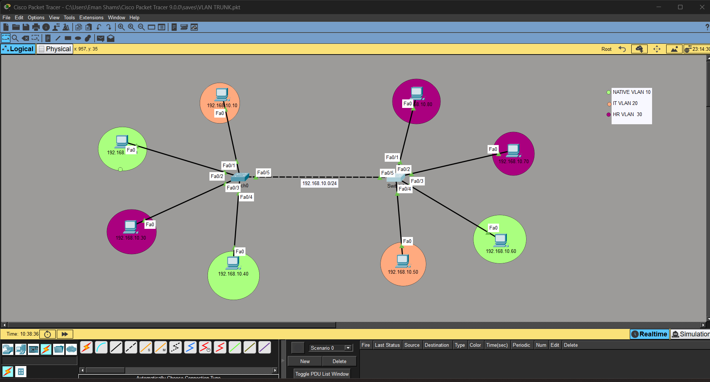
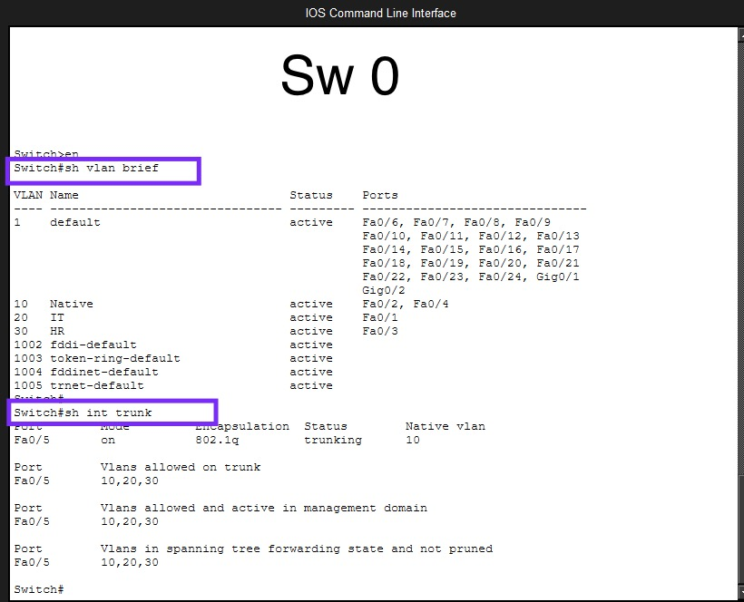
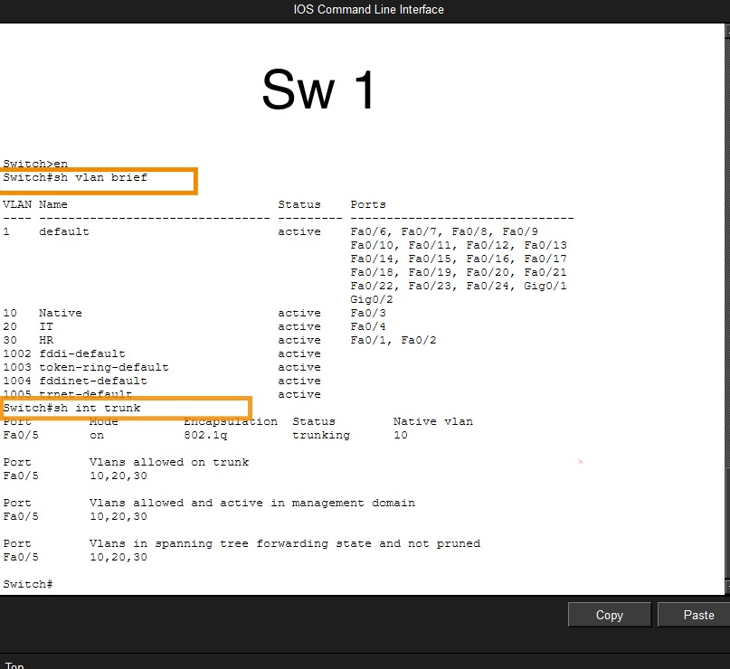

# VLAN Segmentation & Inter-Switch Trunking Lab

## Overview

A hands-on Cisco networking lab focused on VLAN segmentation and trunking between two switches using Cisco Packet Tracer.

## Objective

The objective of this lab was to:

- Create and configure multiple VLANs.
- Assign switch ports to the appropriate VLANs.
- Configure a trunk link between two switches.
- Extend VLANs across both switches.
- Verify VLAN connectivity and troubleshoot configuration issues.

Network Topology

The lab consists of:

* 2 Cisco switches
* Multiple end devices
* 3 configured VLANs
* An 802.1Q trunk link between the switches
* VLANs

  

VLAN ID	Name

10	Native
20	IT
30	HR

Trunk Configuration

* Trunk Port: Fa0/5
* Encapsulation: 802.1Q
* Native VLAN: 10
* Allowed VLANs: 10,20,30

* ## Verification

The configuration was verified using Cisco IOS show commands:

- `show vlan brief`
- `show interfaces trunk`

Connectivity was also tested between devices in the same VLAN across both switches.

## Verification & Testing

### Native VLAN Verification

[▶️ Watch Native VLAN Verification](native-vlan-verify.mov)

## Connectivity Testing

Connectivity was tested between devices in the same VLAN across both switches.

### Ping Test 1

[▶️ Watch Ping Test 1](ping-vlan20.JPG)

### Ping Test 2

[▶️ Watch Ping Test 2](ping-vlan30.mov)

# VLAN Segmentation & Inter-Switch Trunking Lab

## Overview

## Objective

## Network Topology

## VLANs

## Trunk Configuration

## Verification & Testing

## What I Learned

## What I Learned

- How to create and assign VLANs on Cisco switches.
- How to configure an 802.1Q trunk between two switches.
- How to restrict allowed VLANs on a trunk.
- How to verify VLAN and trunk configurations using Cisco IOS commands.
